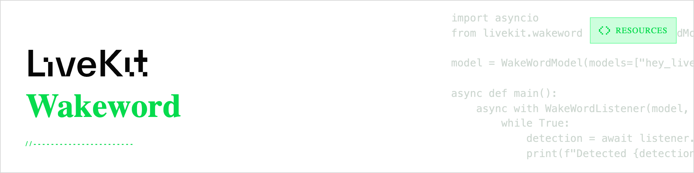
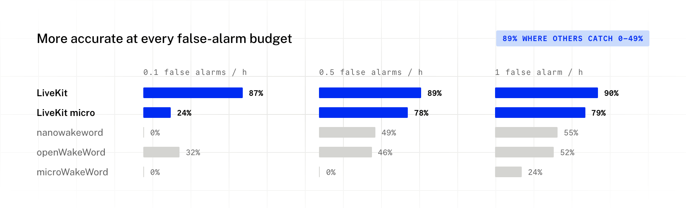
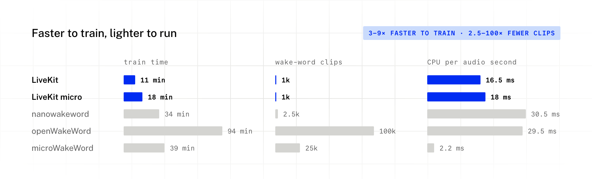

<picture>
  <source media="(prefers-color-scheme: dark)" srcset="/.github/banner_dark.png">
  <source media="(prefers-color-scheme: light)" srcset="/.github/banner_light.png">
  
</picture>

# LiveKit WakeWord

[](client/python)
[](client/swift)
[](client/esp32)
[](LICENSE)

**[Why LiveKit WakeWord](#why-livekit-wakeword) · [Comparison](#comparison) ·
[Guides and examples](#guides-and-examples) · [Train your own](#train-a-wake-word) ·
[Models](#models) · [Development](#development)**

LiveKit WakeWord is an open-source toolkit for training and running wake word models. You provide
a phrase, and the training CLI generates speech with LiveKit Inference TTS and adapts a pretrained
encoder to recognize it. The resulting model runs locally in Python, Swift or on an ESP32, without
sending audio to a server. You do not need to record your own training data.

> [!IMPORTANT]
> The original LiveKit WakeWord implementation, based on openWakeWord, is deprecated.
> LiveKit WakeWord now uses LiveKit's own pretrained encoders. In our “hey livekit” benchmark,
> the standard model detected 89% of wake words at 0.5 false alarms per hour, compared with 46%
> for openWakeWord 0.6. It used 16.5 ms of CPU time per second of audio, compared with 29.5 ms.
> Models from the deprecated implementation are not compatible with the new clients;
> [retrain your phrase](#train-a-wake-word) to upgrade.

## Why LiveKit WakeWord

Training a standard model for “hey livekit” took 11 minutes on one RTX PRO 6000 GPU: about
6 minutes to generate speech and 5 minutes to train, calibrate and export the model. Training
used 1,000 generated wake-word clips. The same workflow produces a micro model in about 18 minutes,
including the standard model it learns from.

The standard model is about 7 MB and runs in Python or Swift through ONNX Runtime. The micro
model is 451 KB and runs on ESP32 through TensorFlow Lite Micro. You can start with a
[ready-made model](#models), or [train a model](#train-a-wake-word) for your own phrase. Running
detection requires neither a GPU nor LiveKit Cloud credentials.

## Comparison

We trained “hey livekit” separately in each engine using its own recipe, then evaluated the
models on the same benchmark. At 0.5 false alarms per hour, LiveKit WakeWord detected 89% of wake
words, nanowakeword 49%, and openWakeWord 46%. Their training times were 11, 34 and 94 minutes,
respectively. Streaming inference used 16.5, 30.5 and 29.5 ms of CPU time per second of audio.

<picture>
  <source media="(prefers-color-scheme: dark)" srcset="/.github/assets/accuracy_dark.png">
  
</picture>

<picture>
  <source media="(prefers-color-scheme: dark)" srcset="/.github/assets/speed_dark.png">
  
</picture>

The micro model detected 78% of wake words at the same false-alarm rate. microWakeWord scored
0% at that operating point, although it used less CPU: 2.2 ms per second of audio versus 18 ms
for LiveKit micro. These results compare the complete training workflows for one phrase,
including their different speech generators; they do not isolate encoder performance.

<details>
<summary>How we compared</summary>

We used [LiveKit WakeWord Bench](https://github.com/livekit/wakeword-bench) with party scenes:
7,873 clips covering unseen voices, noise, rooms, codecs, similar-sounding phrases and
conversational speech, plus 24 hours of TV, music and podcasts. Accuracy in the chart is recall
at 0.1, 0.5 and 1 false alarms per hour. Each model's threshold is selected for that rate; this is different
from setting every model's score threshold to 0.5.

The alternatives used Piper TTS for training speech, while LiveKit WakeWord used LiveKit
Inference TTS. Benchmark voices were held out of training, but the benchmark also uses LiveKit
Inference, which may favor our models.

We tested nanowakeword 3.0 and openWakeWord 0.6 (100,000 samples). For microWakeWord, training
time and clip counts use its scaled-up recipe (25,000 samples, 40,000 steps); accuracy is the
better result from that recipe and its notebook default.

Each pipeline ran alone on one RTX PRO 6000 GPU with the same 8 CPU cores. Training times exclude
one-time downloads: 3.8 GB for LiveKit WakeWord and 21–35 GB for the alternatives. The micro
training time includes its standard teacher model. CPU measurements use one core and one thread
with streaming audio.

</details>

## Guides and examples

Each client has a README with installation and usage instructions, along with examples you can
run. Use a [ready-made model](#models) or one you trained yourself.

| Platform | Installation and usage | Examples |
|---|---|---|
| Python | [Python README](client/python/README.md) | [Audio clip inference](client/python/examples/inference.py) · [Microphone listener](client/python/examples/listener.py) |
| Swift | [Swift README](client/swift/README.md) | [SwiftUI demo for iOS and macOS, with setup instructions](client/swift/Example/README.md) |
| ESP32 | [ESP32 README](client/esp32/README.md) | [I2S microphone detection](client/esp32/examples/i2s_mic) · [Wake word to LiveKit agent](client/esp32/examples/livekit_agent) · [Build and flash instructions](client/esp32/README.md#examples) |

## Models

The [latest release](https://github.com/livekit/livekit-wakeword/releases/latest) has ready-made
models and the pretrained encoders that training starts from:

```bash
gh release download -R livekit/livekit-wakeword -p "*.onnx" -p "*.tflite" -p "*.json"
```

| model | bench score |
|---|:---:|
| `hey_livekit.onnx` | 0.909 |
| `hey_livekit_micro.tflite` | 0.767 |
| `hey_jarvis.onnx` | 0.914 |
| `hey_jarvis_micro.tflite` | 0.716 |

hey livekit is scored on the bench with party scenes (the one in the comparison above), and hey
jarvis on the plain bench. **standard** is ONNX (about 7 MB, about 1 ms per 80 ms step on one CPU
thread). **micro** is int8 TFLite (451 KB, 11.5 million multiply-accumulates per second of
audio) for TensorFlow Lite Micro. At the default threshold of 0.5, these four models give 0.5 to 2.5
false alarms per hour on the bench's conversational speech; raise the threshold if you see too many.

## Train a wake word

You need Python 3.12+, a CUDA GPU or an Apple silicon Mac, [uv](https://docs.astral.sh/uv/) and a LiveKit Cloud project
(the free plan works) for the TTS.

**1. Get LiveKit credentials.** Sign up at [cloud.livekit.io](https://cloud.livekit.io) and create a
project, then install the [LiveKit CLI](https://docs.livekit.io/reference/developer-tools/livekit-cli/)
and log in:

```bash
brew install livekit-cli                         # macOS
curl -sSL https://get.livekit.io/cli | bash      # Linux
winget install LiveKit.LiveKitCLI                # Windows

lk cloud auth                                    # log in in the browser and pick your project
lk app env -w                                    # writes LIVEKIT_URL, LIVEKIT_API_KEY, LIVEKIT_API_SECRET to .env.local
set -a && source .env.local && set +a            # export them in this shell
```

You can also create an API key in the project settings of the LiveKit Cloud dashboard and export
the three variables yourself.

**2. Get the code:**

```bash
git clone https://github.com/livekit/livekit-wakeword && cd livekit-wakeword
uv sync --all-packages --extra tflite            # --extra tflite is for --type micro
```

`setup` downloads the pretrained encoders from the v2.0.0 release once.

**3. Train:**

```bash
uv run livekit-wakeword setup --wakeword "hey robot" --eval  # training speech + held-out test set
uv run livekit-wakeword train --wakeword "hey robot" --type standard
uv run livekit-wakeword eval --wakeword "hey robot"    # bench score on a held-out test set
uv run --with pyaudio livekit-wakeword listen hey_robot.onnx   # try it on your microphone
```

A new phrase takes about 11 minutes on one data-center GPU (6 minutes of speech generation, 5 of
training). The first run downloads about 4 GB of noise, room and speech sources once.

**For ESP32**, also train a micro model (about 7 more minutes):

```bash
uv run livekit-wakeword train --wakeword "hey robot" --type micro   # -> hey_robot_micro.tflite
```

**More speech, or a different output folder:**

```bash
uv run livekit-wakeword setup --wakeword "hey robot" --clips 4      # 4x the default training speech
uv run livekit-wakeword train --wakeword "hey robot" --out models   # writes models/hey_robot.onnx
```

The [training guide](train/README.md#flags) lists every flag, with a full example from setup to
evaluation.

## Repository layout

| | |
|---|---|
| [`train/`](train) | The `livekit-wakeword` CLI: generates speech with LiveKit Inference TTS, trains, calibrates and evaluates (GPU) |
| [`client/python/`](client/python) | Python client: `WakeWordModel`, `WakeWordListener` |
| [`client/swift/`](client/swift) | Swift package for iOS and macOS, plus a SwiftUI demo |
| [`client/esp32/`](client/esp32) | ESP-IDF component and examples for micro models |
| [`models/`](models) | The hey livekit models the tests and examples use |

## Development

```bash
uv sync --all-packages --extra tflite
uv run pytest                                    # Python: client and trainer
uv run ruff check . && uv run mypy -p livekit.wakeword -p livekit.wakeword_train
swift test                                       # Swift client
```

## License

Apache 2.0, see [LICENSE](LICENSE).
